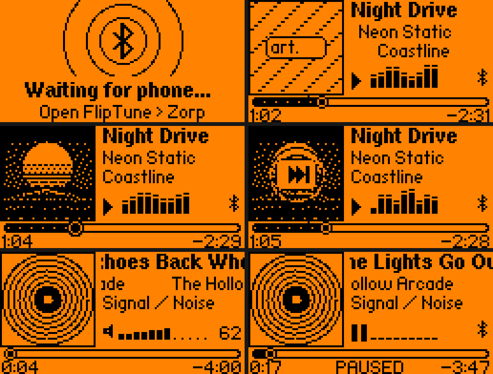

# FlipTune — Apple Music remote for Flipper Zero

Turns a Flipper Zero into a now-playing display and media remote for Apple Music:

- **Pixel-art album cover**: 48×48, Atkinson-dithered to 1-bit.
- **Song, artist and album**: long names scroll as a marquee.
- **Live progress bar**: elapsed and remaining time, plus a playhead that pulses.
- **Remote**: play/pause, next/previous, hold to seek, and volume.
- **Accent animations**:
  - New covers dissolve in through a Bayer pattern with a scanline sweep.
  - On track change, the text slides in, staggered.
  - The equalizer bars dance while music plays and flatten when paused.
  - The progress bar shimmers, and sparks trail the playhead.
  - Each button press sends a ripple across the cover.
  - The Bluetooth rune flickers when data arrives.
  - The waiting screen shows radiating rings.



Animated preview, rendered from the real drawing code: [`docs/preview.gif`](docs/preview.gif)

## How it works (and why there's a companion)

```
┌────────────┐  track / state / 1-bit cover   ┌──────────────┐
│ iPhone app │ ─────────────────────────────▶ │ Flipper Zero │
│  or Mac    │ ◀───────────────────────────── │  FlipTune    │
│  script    │   play/pause, next, seek, vol  └──────────────┘
└────────────┘        BLE (Flipper serial service)
```

A Flipper app can't get song info straight from the iPhone. iOS's built-in
Bluetooth media service (AMS) gives title, artist, album and time to accessories,
but **never sends album art**. Flipper's Bluetooth stack also doesn't let apps act
as the client that AMS needs. So a small companion reads Apple Music's Now Playing
info, dithers the cover into pixel art, and streams it all to the Flipper over the
Flipper's standard BLE serial service. Remote commands travel back the same way.

| Part | Path | What it does |
|---|---|---|
| Flipper app | `flipper_app/` | The `.fap`: UI, animations and remote controls |
| iPhone companion | `companion-ios/` | SwiftUI app using `MPMusicPlayerController.systemMusicPlayer` and CoreBluetooth |
| Mac companion | `companion-mac/` | Python script that drives Music.app through AppleScript; good for testing |
| Preview harness | `tools/preview/` | Renders the real Flipper drawing code to PNG/GIF on a desktop |

## Flipper app

Build with [uFBT](https://github.com/flipperdevices/flipperzero-ufbt). It was built
against the official SDK, firmware 1.5.1 (API 88.2):

```sh
pip install ufbt
cd flipper_app
ufbt            # builds dist/fliptune.fap
ufbt launch     # builds, installs and starts it on a USB-connected Flipper
```

Or copy `dist/fliptune.fap` to `SD:/apps/Bluetooth/`. On the Flipper it appears as
**Apps → Bluetooth → FlipTune Remote**.

| Button | Action |
|---|---|
| OK | Play / pause |
| ◀ / ▶ | Previous / next track |
| Hold ◀ / ▶ | Seek −10 s / +10 s (repeats while held) |
| ▲ / ▼ | Volume |
| Back | Exit (Bluetooth goes back to normal) |

While FlipTune is open, it takes over the Flipper's Bluetooth serial link. The
official Flipper mobile app can't talk to the Flipper until you exit FlipTune.

## iPhone companion

You need a Mac with Xcode 15 or later. A free Apple ID works for signing.

```sh
brew install xcodegen
cd companion-ios
xcodegen          # makes FlipTune.xcodeproj from project.yml
open FlipTune.xcodeproj
```

In Xcode, choose your team under *Signing & Capabilities*, then run the app on your
iPhone. The simulator has no Bluetooth.

1. Open **FlipTune Remote** on the Flipper.
2. In the iPhone app, tap **Find my Flipper** and pick it from the list.
3. The first time, the Flipper shows a 6-digit PIN. Enter it in the iOS pairing prompt.
4. Play something in Apple Music.

The app remembers your Flipper and reconnects automatically whenever FlipTune opens.
It keeps working in the background through the `bluetooth-central` background mode.
To keep iOS from leaving the app suspended, the Flipper polls every 3 s, which wakes
the app.

**iOS limitations:**

- **Volume**: iOS has no public API to set the system volume. FlipTune uses the
  standard `MPVolumeView` workaround, which only works while the companion app is in
  the foreground. Every other control also works in the background.
- **Artwork**: songs streamed from the Apple Music catalog often have no local
  artwork. When that happens, the app looks the album up through the public iTunes
  Search API. If there's still no cover, the Flipper shows a generated pixel pattern
  seeded from the album name.
- **Text**: Flipper fonts are ASCII only, so titles are transliterated (Björk → Bjork,
  坂本龍一 → ban ben long yi).

## Mac companion

```sh
cd companion-mac
pip3 install bleak pillow
python3 fliptune_mac.py               # or: --name <your Flipper's name>
```

macOS will ask for Bluetooth permission for your terminal, and for permission to
control Music. All controls work, including volume (Music.app's own volume) and
real artwork.

## Preview without hardware

```sh
cd tools/preview
python3 extract_fonts.py ~/.ufbt/current/firmware.elf > fonts.h   # the Flipper's real fonts
gcc -O2 -Istubs -o fliptune_preview preview.c -lm
python3 render.py ./fliptune_preview out/   # PNG screens and an animated GIF
```

`render.py` replays a scripted session (connect, track, art, next, volume, seek,
pause) through the real `fliptune.c` and the Mac companion's real framing and
dithering code.

## Protocol

See [`docs/PROTOCOL.md`](docs/PROTOCOL.md). It's small, so writing another companion
(Android, Spotify, a desktop player) is straightforward.
